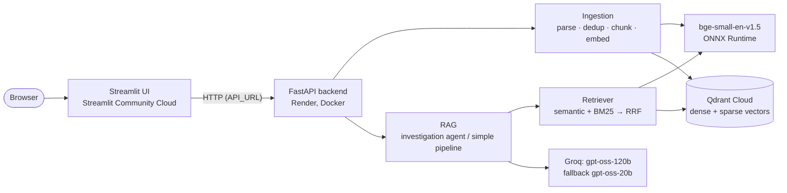

# AI Engine

A question-answering system for investigating incidents across many documents. It finds the
evidence with hybrid search, answers with citations, reports when sources contradict each other,
and says "not enough information" instead of guessing.

Built for the Applied AI task of the Upgaming Talent Growth Program.

| | |
|---|---|
| **Live demo (UI)** | https://upgaming.streamlit.app/ |
| **API** | https://upgaming.onrender.com/ ([Swagger UI](https://upgaming.onrender.com/docs), [server stats](https://upgaming.onrender.com/stats)) |
| **Evaluation Report** | [docs/EVALUATION.md](docs/EVALUATION.md) |
| **AI Usage Report** | [docs/AI_USAGE.md](docs/AI_USAGE.md) |

The demo runs on free tiers: the API sleeps after 15 idle minutes and the first request wakes it
in about a minute (the UI shows a spinner meanwhile). See [Free-tier limits](#free-tier-limits).

## Example

The task's example question, asked on the live demo:

> **Which system changes caused the payment processing disruption in March, which services were
> affected, and which documents confirm this?**
>
> The March payment-processing outage was attributed to a system change that either involved a
> database failover in the primary data centre (as reported on the incident status page) or to an
> expired TLS certificate on the internal payment gateway (as described in the post-mortem and the
> Q1 2026 reliability report) **[1][3][5]**. The only service mentioned as being impacted was the
> card-payments component (EU and US) **[1][3][5]**. …
>
> 🔴 **Sources disagree:** Cause of the disruption: database failover vs. expired TLS certificate [1] [3] [5]

Each citation opens the source chunk (file, page, text). The documents behind it are four files in
four formats that describe one fictional incident and disagree on purpose (see [Dataset](#dataset)).

## Architecture



The UI imports nothing from the backend: it only calls the API, so the two run on different hosts.

**How a question is answered** (`POST /ask`, the default `agent` method):

1. **Retrieve**: the question is embedded and searched twice in Qdrant, with dense vectors
   (semantic) and with BM25 sparse vectors (keywords). The two rankings are fused with Reciprocal
   Rank Fusion; the top 6 chunks become numbered sources.
2. **Investigate**: the LLM reads the sources and may call the `search` tool (up to 2 times,
   3 new sources each) when an answer depends on a fact the sources only mention, e.g. a person
   named in one paragraph whose details are in another.
3. **Answer**: the LLM must call `submit_answer` with the answer text, the sources it used,
   `answered` (false = abstain) and `conflicts` (facts the sources disagree on).
4. **Check**: citations that point to no source are left out of the cited sources and reported
   (the UI shows them), an abstention keeps no citations, and the answer, its sources and conflicts
   go back to the UI.

The `simple` method (one search, one LLM call, top 10 chunks) is kept as a baseline for the
evaluation.

| Module | Responsibility |
|---|---|
| `app/ingestion/parsers/` | TXT, Markdown, PDF, DOCX and JSONL → `Document` (text + metadata) |
| `app/ingestion/chunking/` | Two strategies: `fixed` (sliding window) and `structured` (headings, paragraphs, sentences) |
| `app/ingestion/dedup.py` | Exact duplicates by content hash; other titles of the same text are kept as aliases |
| `app/ingestion/service.py` | Add, update (same file name = new version) and delete files |
| `app/embeddings/embedder.py` | bge-small-en-v1.5 with ONNX Runtime (no torch) |
| `app/retrieval/bm25.py` | Own BM25 document encoder for Qdrant's sparse vectors |
| `app/retrieval/fusion.py` | Reciprocal Rank Fusion of semantic and keyword results |
| `app/storage/qdrant_store.py` | Qdrant collection: dense + sparse vectors, payload indexes, deletes by file |
| `app/rag/agent.py`, `tools.py` | Multi-step investigation agent with `search` and `submit_answer` tools |
| `app/rag/pipeline.py`, `citations.py` | Simple RAG, citation parsing and validation, `RAGAnswer` |
| `app/llm/client.py` | Groq client: error mapping, rate limits, fallback model, token usage |
| `app/api/` | FastAPI routes, schemas, dependencies, the answer cache and server statistics |
| `app/evaluation/` | Recall@K, MRR, citation accuracy, LLM judge |
| `ui/` | Streamlit UI and its HTTP client |
| `scripts/` | Dataset, chunking, embedding, indexing, ingestion and evaluation commands |

## How the task's requirements are met

| Requirement | Implementation |
|---|---|
| ≥ 3 formats, text + metadata | 5 formats: TXT, MD, PDF (per page), DOCX (headings and tables), JSONL; title, file, format, page, author and creation date where the file has them, character offsets |
| Chunking, 2 strategies compared | `fixed` and `structured`, both indexed and compared in the retrieval evaluation |
| Duplicates | SHA-256 of normalized text; 7,145 duplicate paragraphs removed; an upload whose content is already indexed from another file is skipped |
| Add, update, delete | `POST /documents` (same name replaces the old version, embedded before the old one is deleted), `DELETE /documents/{name}` |
| Vector DB, embeddings, semantic search | Qdrant, bge-small-en-v1.5 (384 dimensions, cosine) |
| Hybrid search, custom ranking | Own BM25 encoder (title indexed with the text) + own Reciprocal Rank Fusion |
| Multi-step RAG over several documents | The agent's follow-up searches; answers combine several sources |
| Evidence and citations | Every sentence cites its sources; citations of sources that do not exist are detected and reported |
| Contradictions, abstention | `conflicts` in the answer (red box in the UI); `answered: false` with the reason |
| LLM error handling | Invalid tool calls, per-minute vs daily rate limits, fallback model, API key and connection errors → clear 503 messages |
| Tool calling | `search` and `submit_answer` tools (OpenAI-style function calling on Groq) |
| ≥ 40 evaluation questions, 5 categories | 47 questions: simple, multi-hop, multi-doc, unanswerable, contradictory |
| Recall@K, MRR, answer correctness, citation accuracy | See the [Evaluation Report](docs/EVALUATION.md) |
| ≥ 2 configurations, error analysis | 6 retrieval configurations, 3 answer configurations, retrieval vs generation errors |
| Python backend, functional UI | FastAPI + Streamlit: ask, see sources and conflicts, add, update and delete documents |
| ≥ 50k documents | 66,555 unique HotpotQA paragraphs + the sample documents |
| Free public deployment, persistence, secrets | Render + Streamlit Community Cloud + Qdrant Cloud; keys only in the hosts' environment settings |
| Bonus | Model comparison (gpt-oss-120b vs 20b), agentic RAG, caching (answers to repeated questions, embeddings), monitoring (`GET /stats`: questions, cache hits, answer time p50/p95, LLM tokens, fallback calls, errors, also shown in the UI); partly: a prompt-injection rule (tested by hand only) |

## Dataset

**HotpotQA, distractor setting, validation split**
([hotpotqa/hotpot_qa](https://huggingface.co/datasets/hotpotqa/hotpot_qa)):

| | |
|---|---|
| Questions | 7,405 |
| Paragraphs | 73,700 (10 per question: 2 gold + 8 distractors) |
| Unique paragraphs after deduplication | **66,555** (7,145 duplicates removed) |
| Chunks | 71,588 (`structured`), 73,468 (`fixed`) |

Why this dataset:
- **It is over the 50k requirement and real text**: Wikipedia paragraphs on every topic, so the
  search has to find the right paragraph among tens of thousands.
- **Every question comes with gold evidence**: each question names the paragraphs that support its
  answer (`supporting_facts`), so Recall@K, MRR and citation accuracy can be measured without
  labelling anything by hand.
- **Multi-hop by design**: "bridge" questions need a chain of two paragraphs and "comparison"
  questions need two entities, which is what the multi-step agent is for.
- **Built-in noise**: the 8 distractor paragraphs per question are chosen to look relevant.
- **Reproducible**: the whole validation split is used, downloaded by one script; no sampling.

HotpotQA has no incident reports, so the task's scenario is covered by **four sample documents**
(`data/samples/`, written by `scripts/make_samples.py`) about one fictional incident, INC-2041 at
the fictional company Corvane Pay, in four formats:

| File | Says |
|---|---|
| `inc-2041-postmortem.md` | Expired TLS certificate; 47 minutes; 12% of card transactions failed |
| `inc-2041-status-page.txt` | Database failover; about 65 minutes |
| `inc-2041-support-summary.docx` | 1,384 tickets (table by channel), 214 merchants refunded |
| `reliability-report-q1-2026.pdf` | Expired TLS certificate; 47 minutes; **18%** failed; another incident (INC-2017) |

The contradictions (cause, duration, end time, failure share) are planted on purpose, and some
facts are missing on purpose (the cost of the incident, the on-call engineer's name).

## Ingestion and chunking

- **Parsers** turn each format into documents: a PDF gives one document per page (citations show
  the page), DOCX headings become Markdown headings and tables become text rows, JSONL records
  become one document each with their other fields as metadata.
- **Deduplication** hashes the normalized text. When the same text appears under several titles,
  one copy is kept and the other titles are stored as aliases (the evaluation counts them).
- **`fixed`**: windows of 150 words with a 30-word overlap.
- **`structured`**: splits at Markdown headings into sections, then at paragraph breaks, sentence
  ends and finally words until a piece has at most 150 words; small pieces are merged up to 150
  words, and a section shorter than 30 words joins the next one. The app uses `structured`: a
  section with its heading ("## Root cause") becomes its own chunk, which gives precise citations.
- **Updates**: a file is identified by its name. Uploading the same name embeds the new version
  first, then deletes the old chunks and inserts the new ones, so a failed upload leaves the old
  version in place.
- **Protected files**: the base dataset can never be replaced through the API; on the public demo
  the sample documents are protected too (`PROTECTED_SOURCES`), so a visitor cannot delete them for
  everyone. Visitors can still add, update and delete their own files.

## Search

One Qdrant collection per chunking strategy, with two vectors per chunk:

- **`dense`**: bge-small-en-v1.5, 384 dimensions, cosine. Queries get the model's instruction
  prefix ("Represent this sentence for searching relevant passages: ").
- **`bm25`**: a sparse vector from the project's own BM25 encoder (`app/retrieval/bm25.py`):
  tokenization with accent folding and stopwords, term frequency saturation (k1 = 1.2) and length
  normalization (b = 0.75). Qdrant adds the IDF part (`Modifier.IDF`). The chunk's title is indexed
  with its text: a chunk often does not repeat what its document is about.
- **Hybrid**: 30 candidates from each, fused with Reciprocal Rank Fusion
  (score = Σ 1 / (60 + rank)), which needs no score calibration between cosine and BM25.

Exact identifiers like "GW-503" are found by keyword search and missed by semantic search; the
hybrid mode keeps both strengths.

## Evaluation

Full results, method and error analysis: **[docs/EVALUATION.md](docs/EVALUATION.md)**.

Retrieval (no LLM; 39 answerable questions of the evaluation set, 500 random HotpotQA questions):

| Search mode (structured chunks) | Recall@5 | Recall@10 | MRR | HotpotQA-500 Recall@10 |
|---|---|---|---|---|
| semantic | 0.872 | 0.897 | 0.857 | 0.831 |
| keyword | 0.816 | 0.906 | 0.909 | 0.805 |
| **hybrid** | **0.949** | **0.974** | **0.938** | **0.877** |

Answers (47 questions, graded by an LLM judge of another model family):

| Configuration | Answer correctness | Contradictions handled | Citation accuracy | Tokens / question |
|---|---|---|---|---|
| **agent, gpt-oss-120b** (deployed) | **0.95** | 5 of 6 | 0.97 | 2,284 |
| agent, gpt-oss-20b | 0.95 | 5 of 6 | 0.98 | 2,360 |
| simple RAG, gpt-oss-20b | 0.86 | 0 of 6 | 0.99 | 1,639 |

The agent's advantage comes from contradictions: the simple pipeline read both versions every time
but always gave one. All configurations abstained on all 8 unanswerable questions.

## Performance and cost

| | |
|---|---|
| Backend memory | 270 MB in the container (643 MB before torch was replaced by ONNX Runtime) |
| Query embedding | ~23 ms on a laptop CPU |
| Search | keyword ~18 ms, semantic ~50 ms, hybrid ~52 ms (local Qdrant) |
| Answer | ~1.6 s on average in the evaluation; 3–6 s for multi-source questions |
| LLM tokens | ~2,300 per question (agent), ~1,600 (simple) |
| Indexing the dataset | Embeddings are computed once and cached (`data/processed/*.npz`, keyed by model and chunk file hash); uploading 71,588 points to Qdrant Cloud took 291 s |

Cost control: a question asked again (same method and search mode, any case or spacing) is
answered from an in-memory cache without an LLM call, and the cache is cleared whenever a document
is added, updated or deleted; the agent searches at most twice; the judge runs on a separate
model; the evaluation paces itself under the per-minute token limit; and the embedding model runs
locally (no API cost).

## Running locally

Requirements: Python 3.12, Docker (for Qdrant), a free [Groq](https://console.groq.com) API key.

```bash
python -m venv .venv
.venv\Scripts\activate            # Windows; on Linux/macOS: source .venv/bin/activate
pip install -r requirements-dev.txt
cp .env.example .env              # then set GROQ_API_KEY

docker run -d --name qdrant -p 6333:6333 -v qdrant_storage:/qdrant/storage qdrant/qdrant:v1.20.0
```

Build the index (once; the embedding step takes about 1.5 hours per strategy on a laptop CPU and is
cached afterwards):

```bash
python -m scripts.prepare_dataset         # download HotpotQA -> data/raw/
python -m scripts.build_chunks            # parse, deduplicate, chunk -> data/processed/
python -m scripts.embed_chunks            # embeddings -> data/processed/*.npz
python -m scripts.index_chunks            # upload to Qdrant (--strategies structured for one)
python -m scripts.ingest_files data/samples   # the four INC-2041 documents
```

Run:

```bash
uvicorn app.api.main:app --port 8000           # API, docs at http://127.0.0.1:8000/docs
python -m streamlit run ui/streamlit_app.py    # UI at http://localhost:8501
```

Files can also be managed from the command line: `python -m scripts.ingest_files report.pdf`
(add or update), `python -m scripts.ingest_files --delete report.pdf`.

### Configuration

| Variable | Default | Meaning |
|---|---|---|
| `GROQ_API_KEY` | (required) | Groq API key |
| `GROQ_MODEL` | `openai/gpt-oss-120b` | Answering model |
| `GROQ_FALLBACK_MODEL` | `openai/gpt-oss-20b` | Answers for 10 minutes after the main model's daily limit is used up; empty = no fallback |
| `QDRANT_URL`, `QDRANT_API_KEY` | `http://localhost:6333`, none | Qdrant server |
| `QDRANT_COLLECTION` | `documents` | Collection prefix: `documents_structured` (used by the app), `documents_fixed` |
| `EMBEDDING_MODEL` | `BAAI/bge-small-en-v1.5` | Embedding model (its ONNX export) |
| `PROTECTED_SOURCES` | `[]` | JSON list of files the API cannot replace or delete |
| `ANSWER_CACHE_SIZE` | `256` | Recent answers kept for repeated questions (cleared when documents change); 0 = off |
| `LOG_LEVEL` | `INFO` | Logging level |
| `API_URL` (UI only) | `http://127.0.0.1:8000` | Where the UI finds the API |

Secrets live only in `.env` (git-ignored) locally and in the hosts' environment settings when
deployed; `GROQ_API_KEY` and `QDRANT_API_KEY` are `SecretStr` and never appear in logs.

### Tests

```bash
python -m pytest
```

142 unit tests with fakes for the LLM, the vector store and the embedder (no network, a few
seconds): the ingestion service (updates, duplicates across files, protected files), RRF, the
embedder's batching, citations, the simple pipeline, the agent loop (tool calls, forced final
answer, invalid tool calls), the LLM client (rate limits, fallback), the API (status codes, uploads,
protected files, the answer cache, the statistics), the UI's HTTP client, the metrics and the judge. The parsers were checked by
hand on sample and broken files (empty, truncated, password-protected).

### Evaluation commands

```bash
python -m scripts.build_eval_set                       # data/eval/questions.jsonl
python -m scripts.eval_retrieval                       # Recall@K, MRR (no LLM)
python -m scripts.eval_answers                         # agent and simple with GROQ_MODEL
python -m scripts.eval_answers --model openai/gpt-oss-20b
python -m scripts.analyze_errors                       # retrieval vs generation errors
```

`eval_answers` saves every answer as it goes and continues where it stopped, because the free
tier allows 200K tokens per day.

## Deployment

| Part | Host | Notes |
|---|---|---|
| API | Render, Docker web service (`Dockerfile`) | Health check `/health`; the embedding model is baked into the image, so the app never contacts the Hugging Face Hub at run time |
| UI | Streamlit Community Cloud, `ui/streamlit_app.py` | Installs only `ui/requirements.txt`; secret `API_URL` |
| Vectors | Qdrant Cloud, free cluster | Only `documents_structured`, filled from the local cache with `index_chunks --strategies structured` |

Render environment: `GROQ_API_KEY`, `QDRANT_URL`, `QDRANT_API_KEY` and `PROTECTED_SOURCES` (the four
sample files). Pushes to `main` redeploy the UI; on Render, Auto-Deploy must be on for the API to
follow. Once, a deploy marked "live" still served the previous code: **Clear build cache & deploy**
fixed it. A quick check that the new code runs: a field added to a response shows up in
`/openapi.json`.

### Free-tier limits

| Service | Limit | Effect |
|---|---|---|
| Render (free web service) | 512 MB RAM, sleeps after 15 min without requests, 750 h per month, no persistent disk | First request after a pause takes ~1 min; nothing is stored on the server (data is in Qdrant) |
| Streamlit Community Cloud | Up to 2.7 GB RAM, sleeps after 12 h without traffic | A sleeping app is woken with one click |
| Qdrant Cloud (free cluster) | 1 GB | Room for one collection (71,597 points) |
| Groq, gpt-oss-120b | 8K tokens/min, 200K tokens/day, 1K requests/day (same for gpt-oss-20b, separately) | About 85 agent questions per day; then gpt-oss-20b answers |

## Limitations and future work

- **Chunk crowding**: several chunks of one document can fill the 6 sources the agent reads. In
  the evaluation this hid the status page in one contradiction question (it was chunk #7). A limit
  of chunks per document or a larger `top_k` would help.
- **Incomplete citations on multi-hop answers**: answers are usually right but often cite only one
  link of the chain (citation coverage 0.86).
- **Cost of abstaining**: the agent searches twice before it gives up, so an unanswerable question
  costs about 3 times the tokens of the simple pipeline.
- **Small evaluation set**: with 47 questions one question is 2 points, so the difference between
  gpt-oss-120b and gpt-oss-20b is within noise.
- **The LLM is not deterministic**: even at temperature 0 the same question can get different
  answers on Groq.
- **Free tiers**: cold starts, daily token limits, and a 1 GB vector database.

## Project structure

```
app/            backend: api, core (config, logging), embeddings, evaluation, ingestion, llm, rag, retrieval, storage
ui/             Streamlit UI and its HTTP client (own requirements.txt)
scripts/        command-line steps: dataset, chunks, embeddings, indexing, ingestion, evaluation
tests/unit/     unit tests
data/samples/   the four INC-2041 documents
data/eval/      evaluation questions and results
docs/           Evaluation Report, AI Usage Report
Dockerfile      the API image for Render
```
